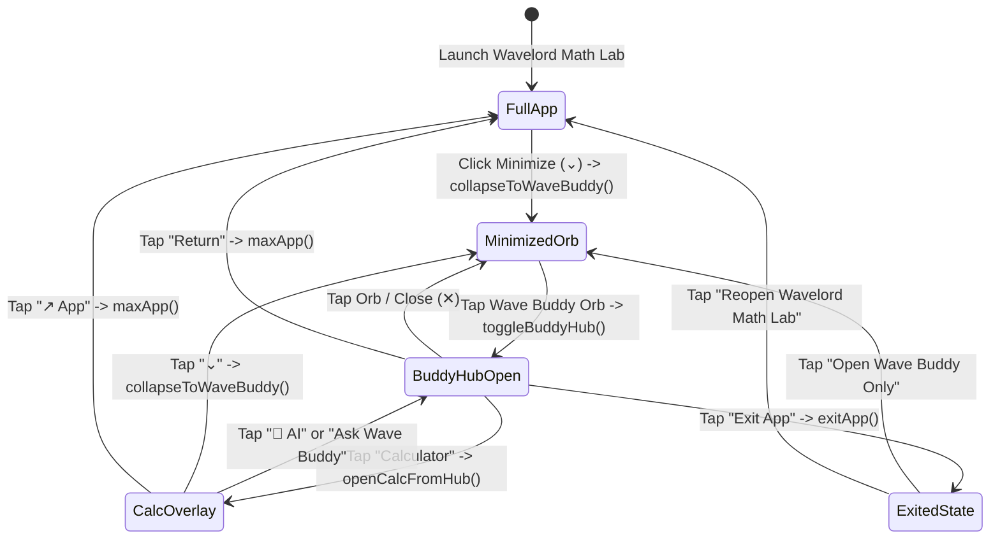

# Wavelord Math Lab — Master Codex

> [!abstract] Executive Summary
> **Wavelord Math Lab** is an interactive 3D/2D visual mathematics studio paired with a unified floating overlay companion called **Wave Buddy** (`#buddyBub` / `FloatingService`). It combines 26 interactive Math Topics, 9 Visual Studio simulations (Three.js + HTML5 2D Canvas), a draggable Scientific Calculator, a multi-turn AI tutor with **Voice Note (VN) transcription to text** and **Read-Aloud TTS**, and a dual Web + Android `SYSTEM_ALERT_WINDOW` collapse architecture.

---

## 1. System Architecture Map

```mermaid
flowchart TB
    subgraph Client["Frontend SPA (/index.html)"]
        UI["3D Three.js + 2D Canvas Stage\n& Topic Inspector Panel"]
        Calc["Floating Scientific Calculator\n(#fcalc)"]
        Orb["Draggable Wave Buddy Calculator Orb\n(#buddyBub — /icon-192.png)"]
        Hub["Unified Wave Buddy Hub (#buddyHub)\nTalk to AI · Calculator · Return · Exit"]
        VN["Voice Note Pipeline\nLive Mic (SpeechRecognition + MediaRecorder)\n+ Audio File Upload (📎)"]
        Fallback["Offline Math Engine\n(buildLocalMathFallback)"]
    end

    subgraph Server["Express Backend (/server.js :3000)"]
        AI["POST /api/ai\n& /.netlify/functions/ai"]
        Transcribe["POST /api/transcribe\n(25MB JSON Limit)"]
        TTS["POST /api/tts"]
    end

    subgraph Providers["AI Providers"]
        GemChat["Gemini: gemini-4-hydrogen"]
        GemSTT["Gemini: gemini-3.5-transcribe"]
        GemTTS["Gemini: gemini-3.8-flash-lite-tts"]
        GroqChat["Groq: openai/gpt-oss-20b"]
        GroqSTT["Groq: whisper-large-v3-turbo"]
    end

    subgraph Android["Android Native Wrapper (/overlay/*.java)"]
        MainAct["MainActivity.java\n(AndroidMinimize JS Bridge)"]
        FloatSvc["FloatingService.java\n(Single Wave Buddy Overlay Bubble\n+ AndroidOverlay JS Bridge)"]
    end

    UI -->|Minimize ⌄| Orb
    Orb -->|Tap| Hub
    Hub -->|Talk to AI| AI
    Hub -->|Use Calculator| Calc
    Hub -->|Return| UI
    VN -->|Audio Base64| Transcribe
    AI --> GemChat
    AI -.->|Fallback if Gemini fails & Groq key present| GroqChat
    AI -.->|Offline fallback| Fallback
    Transcribe --> GemSTT
    Transcribe -.->|Fallback if Gemini fails & Groq key present| GroqSTT
    TTS --> GemTTS
    UI -->|AndroidMinimize.minimize()| MainAct
    MainAct -->|Starts| FloatSvc
    FloatSvc -->|AndroidOverlay Bridge| Hub
```

---

## 2. File Inventory & Ownership

| File | Layer | Responsibility |
| :--- | :--- | :--- |
| `[[/index.html]]` | Frontend SPA | Complete UI, CSS design tokens, 35 math/visual topics, Three.js + 2D Canvas renderers, Scientific Calculator, Wave Buddy orb/hub, VN recorder/uploader, TTS playback, AeroLog error tracker, and Android bridge calls. |
| `[[/server.js]]` | Backend API | Express server on `0.0.0.0:3000` serving static files plus `POST /api/ai`, `POST /.netlify/functions/ai`, `POST /api/transcribe`, and `POST /api/tts`. |
| `[[/package.json]]` | Runtime Manifest | ESM Node.js configuration (`"type": "module"`), `express` + `@google/genai` dependencies, `dev`/`start`/`build`/`lint` scripts. |
| `[[/.env.example]]` | Environment Spec | Documents `GEMINI_API_KEY` and `GROQ_API_KEY` without committing secrets. |
| `[[/overlay/FloatingService.java]]` | Android Service | Single unified draggable **Wave Buddy** overlay bubble (`TYPE_APPLICATION_OVERLAY`), quick-action menu (**Talk to AI**, **Calculator**, **Return to App**, **Exit App**), and floating `WebView` with mic permissions. |
| `[[/overlay/MainActivity.java]]` | Android Activity | Full-screen `WebView` host registering `window.AndroidMinimize` and `WebChromeClient` runtime audio permission grants. |
| `[[/AndroidManifest.xml]]` | Android Manifest | Declares `INTERNET`, `SYSTEM_ALERT_WINDOW`, `FOREGROUND_SERVICE`, and `RECORD_AUDIO` permissions plus `MainActivity` & `FloatingService`. |
| `[[/manifest.json]]` | PWA Manifest | App metadata, theme colors (`#07070f`), and launcher icons (`icon-192.png`, `icon-512.png`). |
| `[[/icon-192.png]]`, `[[/icon-512.png]]` | Brand Assets | Dark-navy 3D calculator with glowing cyan/violet sine wave screen — also powers the Wave Buddy floating orb. |
| `[[/.github/workflows/build-apk.yml]]` | CI/CD Pipeline | GitHub Actions workflow wrapping the web assets via Capacitor into a debug APK with `overlay/*.java` and `AndroidManifest.xml`. |
| `[[/netlify/functions/ai.js]]` | Legacy Function | Original Netlify serverless handler kept for repo history; Node/Express runtime routes `/.netlify/functions/ai` directly to `handleAiRequest` in `/server.js`. |

---

## 3. Core UX Flows & State Machine

### 3.1 Minimize & Collapse State Machine

> [!info] Design Rule: Single-Point Collapse
> Minimizing (`⌄`) must **never** leave behind the sidebar, welcome landing card, 3D stage, ending screen, or a forced open calculator. Everything collapses cleanly into **only** the draggable **Wave Buddy** calculator orb (`#buddyBub`).



### 3.2 Web vs. Android Overlay Rendering

- **Web / Browser / Iframe Mode**:
  - `html.is-minimized, body.is-minimized` renders a dark ambient radial backdrop (`#12152b` → `#070811`) instead of `transparent` (because `transparent` in standard browsers/iframes exposes a stark white browser canvas behind the orb).
  - `#main`, `#sidebar`, and `#exitScreen` are hidden with `display: none !important; visibility: hidden !important; pointer-events: none !important;`.
- **Android Native Overlay Mode**:
  - `syncAndroidOverlayClass(true)` applies `.android-overlay` when `window.AndroidMinimize` is detected, switching the minimized background to `transparent !important`.
  - Calling `collapseToWaveBuddy()` inside Android also calls `window.AndroidMinimize.minimize()`, which starts `[[/overlay/FloatingService.java]]` and backgrounds `MainActivity` so Wave Buddy floats over other apps.
  - Inside `FloatingService`, tapping the Wave Buddy orb opens a native 4-button menu (**Talk to AI**, **Use Calculator**, **Return to App**, **Exit App**), and the floating `WebView` injects `window.AndroidOverlay` (`returnToApp()`, `exitOverlay()`).

---

## 4. Debug Log: Root Causes & Verified Solutions

> [!bug] Bug #1 — Minimize Opened Calculator & "Ending Page" / Blank Screen
> **Symptom:** Tapping Minimize previously triggered `collapseToCalc()`, forcing `#fcalc` open on a dark/blank overlay, while `Exit` opened an ending page (`#exitScreen`) with missing or conflicting `exitApp()` references (`ReferenceError: exitApp is not defined` in the original HTML). Furthermore, `background: transparent !important` caused a white-screen effect inside web iframes.
>
> **Root Cause:**
> 1. Two separate collapse paths existed (`collapseToCalc` vs. `buddyBub` + `waiterBub`).
> 2. `exitApp()` was referenced in markup before being defined or properly wired.
> 3. Unconditional `background: transparent` on `html.is-minimized` lets the host white canvas show through in browser contexts.
>
> **Solution:**
> - Created `collapseToWaveBuddy()` to close `#exitScreen`, `#fcalc`, and `#buddyHub`, toggle `.is-minimized`, and keep **only** `#buddyBub` visible.
> - Routed topbar `⌄` Minimize and Calculator `⌄` directly to `collapseToWaveBuddy()`.
> - Scoped `background: transparent !important` strictly to `.android-overlay` and used a sleek dark radial backdrop on web.

> [!bug] Bug #2 — AI Companion Failing Silently or Throwing 400 Errors
> **Symptom:** Wave Buddy AI chat failed on every request and displayed raw JSON RPC error dumps inside the bubble.
>
> **Root Causes:**
> 1. **Gemini History Turn Order Violation:** `initChatGreeting()` seeded `chatHistory` with `{ role: 'model', text: ... }`. Sending that greeting as the first element in `contents` violated Gemini's `generateContent` requirement that `contents` must start with a `user` turn.
> 2. **Invalid/Unselected `GEMINI_API_KEY` in Runtime Container:** Testing `POST /api/ai` directly against Gemini returned `400 API_KEY_INVALID`, while `GROQ_API_KEY` was configured in the runtime.
> 3. **Raw JSON Leakage:** Client code previously printed raw provider response bodies directly inside chat `<small>` tags.
>
> **Solutions:**
> - Filtered greeting, fallback, and `'Thinking...'` entries out of `priorHistory` on the client (`index.html`).
> - Added `normalizeGeminiHistory()` in `[[/server.js]]` so `contents` never starts with `role: 'model'`.
> - Added `formatCleanAiError()` in `[[/server.js]]` to parse nested JSON errors into crisp user-actionable messages (`API_KEY_INVALID`, `RATE_LIMITED`, `NO_API_KEY`).
> - Kept `gemini-4-hydrogen` primary and fell back to `GROQ_API_KEY` (`openai/gpt-oss-20b`) when configured, plus `buildLocalMathFallback()` offline (solving `% of`, linear equations `ax + b = c`, factors, prime checks, and word arithmetic like `"square root of 144"`).

> [!bug] Bug #3 — Two Disconnected Android Overlay Bubbles ("Math Buddy" + "Waiter")
> **Symptom:** `[[/overlay/FloatingService.java]]` still spawned two bubbles (`buddyView` and `waiterView`) that didn't match the unified Wave Buddy experience.
>
> **Solution:** Rewrote `[[/overlay/FloatingService.java]]` into one draggable calculator-styled **Wave Buddy** orb (`#070811` + `#22D3EE` stroke) whose tap action presents the 4 unified commands (**Talk to AI**, **Use Calculator**, **Return to App**, **Exit App**) and exposes `window.AndroidOverlay` to the floating `WebView`.

> [!bug] Bug #4 — Mobile Touch Orbit Broken on 3D Three.js Stage
> **Symptom:** Dragging the 3D stage worked with a mouse on desktop (`e.movementX`/`e.movementY`) but froze on mobile touchscreens.
>
> **Root Cause:** Pointer touch events on mobile browsers often omit `movementX`/`movementY` or report `0`.
>
> **Solution:** Replaced `movementX`/`movementY` with explicit `lastPtrX`/`lastPtrY` delta tracking on `pointerdown`/`pointermove` plus `wheel` zoom on desktop.

> [!bug] Bug #5 — Gemini TTS Payload Error on Unconfigured/Legacy Endpoint
> **Symptom:** Calling `POST /api/tts` returned `400 Invalid JSON payload received. Unknown name "speechMetadata" ... "speechConfig"` when `GEMINI_API_KEY` hit an incompatible/invalid endpoint.
>
> **Solution:** Kept the official `gemini-3.8-flash-lite-tts` schema in `[[/server.js]]` (for valid AI Studio Gemini keys), improved `formatCleanAiError()` to unwrap nested JSON messages cleanly, and ensured `speakText()` in `[[/index.html]]` transparently falls back to browser `window.speechSynthesis` so read-aloud never breaks for users.

---

## 5. Voice Note (VN) Transcription Pipeline

> [!tip] Dual-Path Voice Note Support
> Wave Buddy supports **two** ways to convert voice notes to text so users are never blocked by browser mic restrictions:
> 1. **Live Mic Recording (`🎙️`):** Runs `SpeechRecognition || webkitSpeechRecognition` for real-time interim captions **plus** `MediaRecorder` (`audio/webm`), sending the final audio blob to `POST /api/transcribe`.
> 2. **Voice Note File Upload (`📎`):** Accepts `.ogg`, `.opus`, `.m4a`, `.mp3`, `.wav`, and `.webm` voice notes (up to 16 MB client / 25 MB Express limit) and sends Base64 audio to `POST /api/transcribe`.

### Server Transcription Flow (`POST /api/transcribe`)
1. Strips codec suffixes (e.g. `audio/webm;codecs=opus` → `audio/webm`) and normalizes `audio/opus` → `audio/ogg`.
2. Calls **`gemini-3.5-transcribe`** via `@google/genai` (`inlineData` + transcription prompt).
3. If Gemini fails and `GROQ_API_KEY` is present, falls back to Groq Whisper (`whisper-large-v3-turbo`) via native Node `FormData` + `Blob`.
4. If neither succeeds, returns a clean structured error (`NO_API_KEY` / `API_KEY_INVALID` / `RATE_LIMITED`).

---

## 6. API Contract Reference

| Endpoint | Method | Request Body | Success Response | Error Codes |
| :--- | :--- | :--- | :--- | :--- |
| `/api/ai` (alias `/.netlify/functions/ai`) | `POST` | `{ persona, question, topic, context, history }` | `{ answer, provider }` (`200`) | `400`, `429`, `500`, `503` |
| `/api/transcribe` | `POST` | `{ audioBase64, mimeType }` | `{ text, provider }` (`200`) | `400`, `429`, `500`, `503` |
| `/api/tts` | `POST` | `{ text }` | `{ audioBase64, mimeType: "audio/wav" }` (`200`) | `400`, `429`, `500`, `503` |

---

## 7. Playbook for Coders & AI Agents

> [!warning] Critical Guardrails Before Editing This Codebase
> 1. **Never send `role: 'model'` as the first history item** to Gemini `generateContent`. Always pass through `normalizeGeminiHistory()`.
> 2. **Never use `e.movementX` / `e.movementY`** for canvas/3D dragging — mobile `PointerEvent`s require manual `lastPtrX` / `lastPtrY` deltas.
> 3. **Keep Minimize & Exit distinct on Web vs. Android:** Web minimize uses dark ambient background (`#070811`) so the page doesn't turn white; Android overlay uses `.android-overlay` (`transparent`).
> 4. **Always validate inline `<script>` blocks** with Node's `vm.Script` after editing `[[/index.html]]`, because `node --check server.js` only validates backend syntax.
> 5. **Never hardcode API keys** in `index.html`, `server.js`, or `overlay/*.java`. Configure `GEMINI_API_KEY` (and optional `GROQ_API_KEY`) via environment variables / **Settings > Secrets**.

### Verification Commands (Quick Checklist)
```bash
# 1. Validate backend JS syntax
node --check server.js

# 2. Validate inline <script> blocks inside index.html
node -e "const fs=require('fs'),vm=require('vm');const html=fs.readFileSync('index.html','utf8');[...html.matchAll(/<script\b[^>]*>([\s\S]*?)<\/script>/gi)].forEach((m,i)=>{if(m[1].trim())new vm.Script(m[1],{filename:'block_'+i+'.js'});});console.log('OK');"

# 3. Smoke-test HTTP & AI endpoints on port 3000
curl -s -o /dev/null -w "%{http_code}\n" http://127.0.0.1:3000/
curl -s -X POST http://127.0.0.1:3000/api/ai -H "Content-Type: application/json" -d '{"question":"What is 20% of 80?"}'
```

### Recommended Roadmap Ideas
- **Interactive Equation Plotter:** Parse spoken or typed `y = ...` functions from Wave Buddy directly onto the 2D Canvas.
- **PWA Service Worker (`sw.js`):** Cache `/index.html`, `/manifest.json`, and `/icon-192.png` for instant offline mobile launch.
- **Spaced-Repetition Voice Quizzes:** Speak quiz prompts via `/api/tts` and grade spoken voice answers via `/api/transcribe`.
